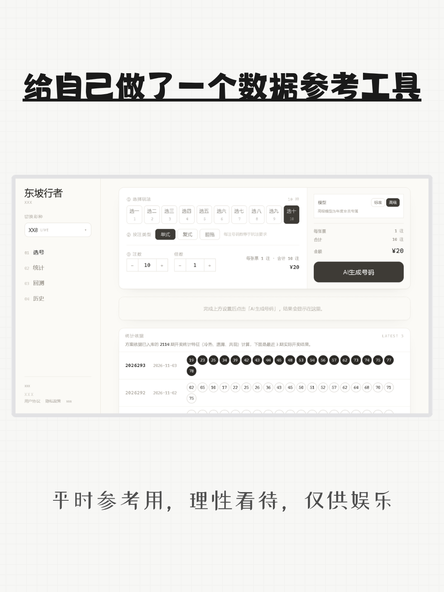
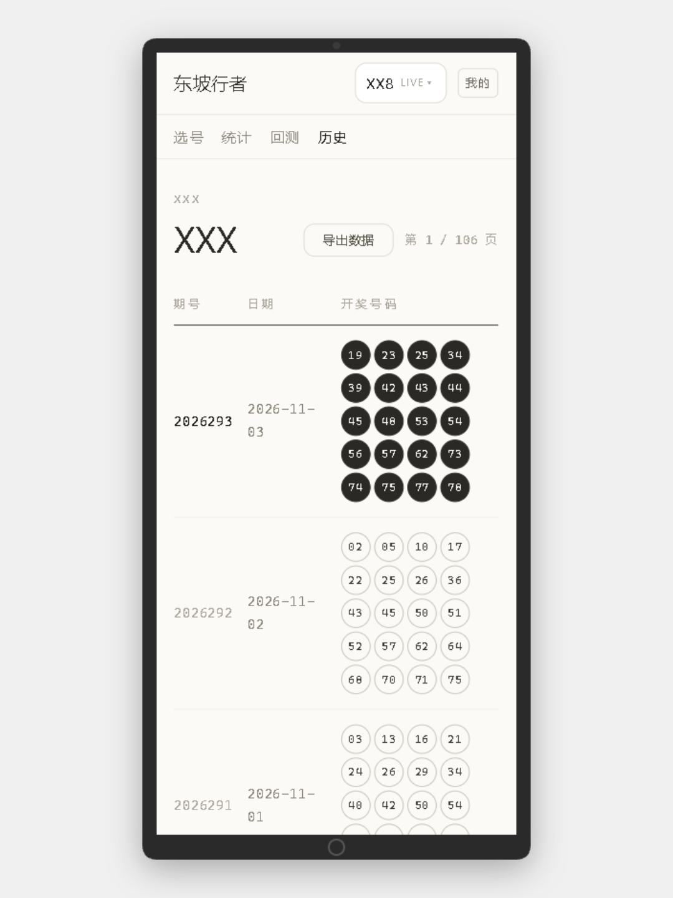
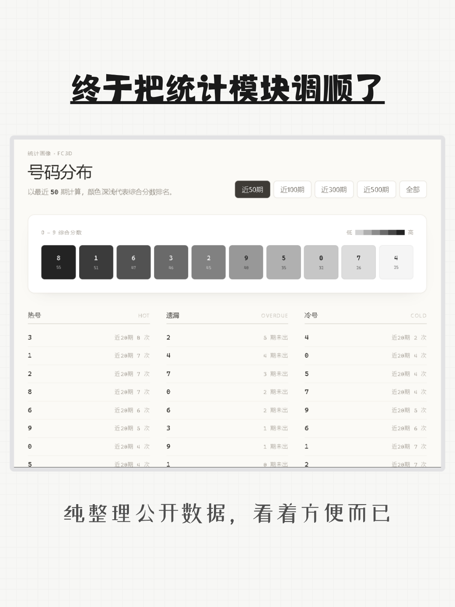
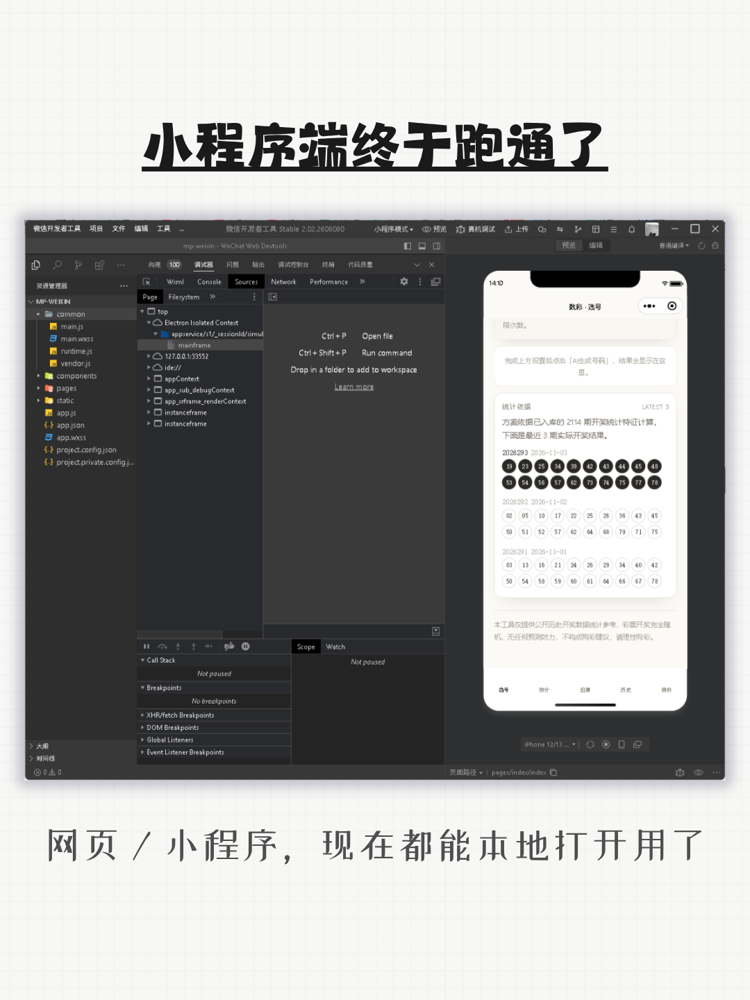
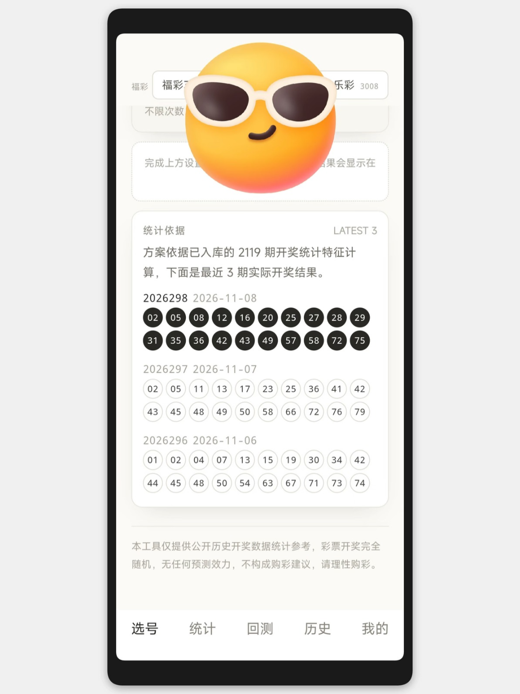
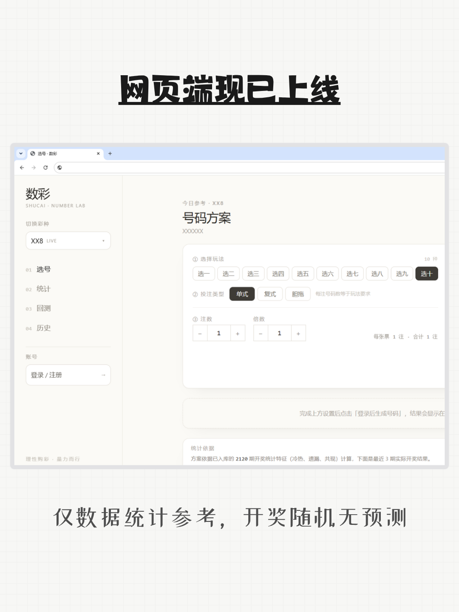

# 数彩 - SHUCAI · NUMBER LAB
一款面向彩票爱好者的历史数据统计、走势复盘工具。

### 界面预览

  
  
  

  
  
  

## 功能介绍
- 多彩种历史开奖数据汇总
- 冷热、遗漏、共现等指标统计
- 选号方案生成、策略回测
- 网页端访问使用

## 重要声明（必读）
本工具仅用于公开开奖数据的统计、复盘、爱好者研究，**不具备开奖预测能力，无法提高中奖概率**。
彩票开奖是独立随机事件，历史数据不能决定后续开奖结果。
禁止将本工具作为投资、盈利手段，请理性娱乐，量力而行。
本项目不提供任何购彩服务，不售卖彩票，不承诺任何收益。

## 访问地址
[https://shucai.nauyx.top](https://shucai.nauyx.top)

## 提示
本仓库仅用于产品展示，不存放源代码，不提供源码下载。

## 交流群

- [TG](https://t.me/+EG_qE2UbAKA2ZThl)
- QQ群：1045431931
